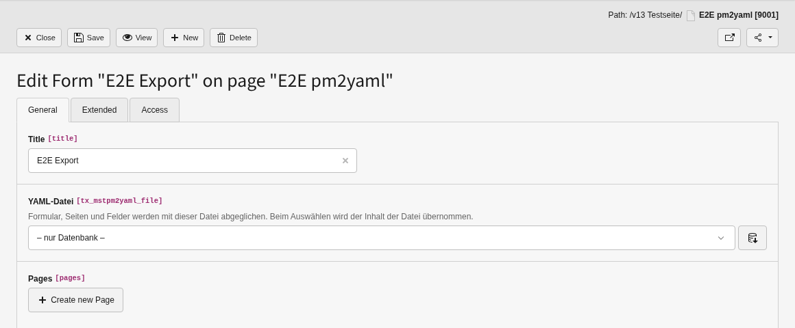

# Usage

## Selecting a file

The form has a field **YAML-Datei** (YAML file). The choices are

- all files `Configuration/Powermail/*.yaml` of all active extensions (**versioned**),
- all `*.yaml` and `*.yml` files in the site folder (**not versioned**, default `fileadmin/_Powermail/`),
- **– nur Datenbank –** (database only): no link, Powermail works as before.

Selecting a file imports its content into the database, **the file wins**.



## Moving an existing form into a file

In the backend: open a form without a file and click the export button next to the field **YAML-Datei** (see screenshot above). The form
is written to the site folder (file name derived from the title, `-2`, `-3` … on collisions) and linked.

On the command line, also for versioned files inside an extension:

```bash
vendor/bin/typo3 pm2yaml:export 12 --file=EXT:my_sitepackage/Configuration/Powermail/contact.yaml
```

## Everyday work

| Action | Effect |
|---|---|
| Edit the file in your editor, open the page in the frontend | The file is imported if its modification time changed. |
| Save a field, page or form in the backend | The file is rewritten (live workspace only, only if writable). A message confirms it. |
| Open a plugin, form, page or field in the backend | A changed file is imported first, so the form always shows the state of the file. |
| Save a draft in a workspace | The file stays untouched, publishing writes it. |
| Rename a field in the file (change the marker) | It is a **new** field. The old one is deleted, stored mails keep pointing to the old one. |

## Versioned forms and write protection

A file below `EXT:…/Configuration/Powermail/` is **read-only** as soon as

- the context is not `Development` (staging, production), or
- the extension is located below `vendor/` or the directory is not writable.

A read-only form only allows changing the file selection in the backend ("database only" removes the link).
Changing, creating, deleting, moving and translating pages and fields is rejected. Changes belong into the file
and therefore into the repository.

Files in the site folder are **always** editable.

## Deployment

Versioned files go live together with the code. To make the database pick them up, the deployment runs:

```bash
vendor/bin/typo3 pm2yaml:sync --only-locked
```

`--only-locked` restricts the run to versioned forms that are read-only in that environment. With `--dry-run`
nothing is saved, the files are only checked. After rolling back the files, run it by hand if needed.
